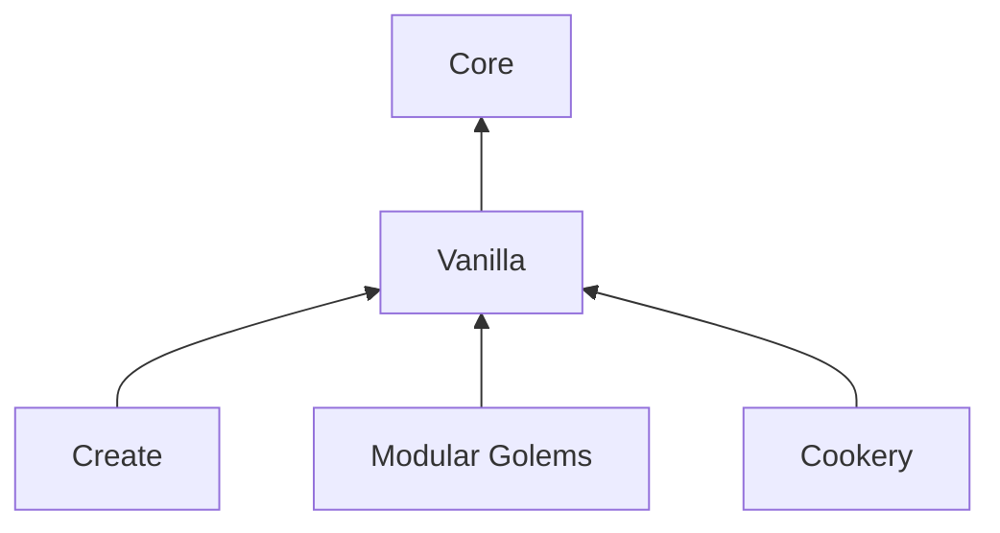

# Architecture

[Documentation](README.md) · [简体中文](../zh-CN/architecture.md)

## Modules

Folkways has **two required mods and three optional extensions**, each a Gradle
project under `mods/`. They use separate mod IDs and share the `folkways`
content namespace. The root project runs tests and collects jars rather than
building a sixth mod.

| Gradle project                          | Mod ID                   | Responsibility                                                                        |
| --------------------------------------- | ------------------------ | ------------------------------------------------------------------------------------- |
| `:core` → `mods/core`                   | `folkways_core`          | Colony engine, public APIs, screens and lessons; supplies no resident work on its own |
| `:vanilla` → `mods/vanilla`             | `folkways_vanilla`       | Residents and their work among vanilla blocks                                         |
| `:create` → `mods/create`               | `folkways_create`        | Rail, dispatch, track joints and schematic hand-off                                   |
| `:modulargolems` → `mods/modulargolems` | `folkways_modulargolems` | Golems as residents                                                                   |
| `:cookery` → `mods/cookery`             | `folkways_cookery`       | Native Cookery farming, appliances, shared tools and lessons                          |

Core handles integrations needed to read an existing world correctly, such as
Sable sub-levels and Create contraptions. Integrations that add work belong in
their own extension mod.

## Source map

Java package paths below are relative to
`src/main/java/io/github/izakyl/folkways/` within the module:

| Module / package                 | Contents                                                                                       |
| -------------------------------- | ---------------------------------------------------------------------------------------------- |
| Core / `base`                    | Declaration ledger, NBT persistence and mixin plugin base                                      |
| Core / `effect`                  | Resident stats, flags and modifiers; perks in `effect/perk`                                    |
| Core / `library`                 | Data pack and loose-file content library                                                       |
| Core / `core`                    | Residents, planning, labor and travel; public `core/api` and world integration in `core/shell` |
| Core / `front`                   | Screens, Colony Book, networking and lessons; public `front/api`                               |
| Vanilla / `plugins`              | Farming, pasture, building and other plugins over the public APIs                              |
| Create / `create`                | Rail, dispatch and `create/build`                                                              |
| Modular Golems / `modulargolems` | Golem residents                                                                                |
| Cookery / `cookery`              | Native appliance and farming adapters, tools and lessons                                       |

Built-in patterns live under
[`mods/vanilla/src/main/resources/data/folkways/folkways/pattern/`](../../mods/vanilla/src/main/resources/data/folkways/folkways/pattern/).
Integration dependencies and mod IDs are declared in each module's `build.gradle`
and `src/main/resources/META-INF/neoforge.mods.toml`.

## Lifecycle and test ownership

[`ColonyLifecycle`](../../mods/core/src/main/java/io/github/izakyl/folkways/core/api/colony/ColonyLifecycle.java)
provides relocation and closing hooks. Closing listeners use
[`Cleanup`](../../mods/core/src/main/java/io/github/izakyl/folkways/base/task/Cleanup.java)
so that an ordinary failure does not stop the remaining cleanup phases. Lifecycle
changes should retain this isolation; the regression scenarios live in
[`ClosingIsolationGameTests`](../../mods/core/src/gametest/java/io/github/izakyl/folkways/core/engine/colony/ClosingIsolationGameTests.java).

Tests belong to the module owning the behavior, including tests that need
package-private internals. Core's `src/gameTestFixtures` contains reusable helpers
without test registration. An integration can reuse them without discovering
Core's tests. Selecting a GameTest owner does not remove the other runtime mods
its scenarios need. See [Testing](testing.md) for selection flags and CI profiles.
