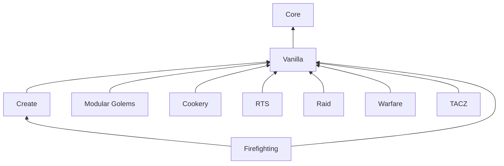

# Architecture

[Documentation](README.md) · [简体中文](../zh-CN/architecture.md)

## Modules

Folkways has **two required mods and eight optional extensions**, each a Gradle
project under `mods/`. They use separate mod IDs and share the `folkways`
content namespace. The root project runs tests and collects jars rather than
building a mod of its own.

| Gradle project                          | Mod ID                   | Responsibility                                                                         |
| --------------------------------------- | ------------------------ | -------------------------------------------------------------------------------------- |
| `:core` → `mods/core`                   | `folkways_core`          | Colony engine, public APIs, screens and lessons; supplies no resident work on its own  |
| `:vanilla` → `mods/vanilla`             | `folkways_vanilla`       | Residents and their work among vanilla blocks                                          |
| `:create` → `mods/create`               | `folkways_create`        | Rail, dispatch, elevators, track joints and schematic hand-off                         |
| `:modulargolems` → `mods/modulargolems` | `folkways_modulargolems` | Golems as residents                                                                    |
| `:rts` → `mods/rts`                     | `folkways_rts`           | Optional direct combat commands, squads and tactical UI                                |
| `:cookery` → `mods/cookery`             | `folkways_cookery`       | Native Cookery farming, appliances, shared tools, Kaleidoscope Tavern wine and lessons |
| `:warfare` → `mods/warfare`             | `folkways_warfare`       | Optional Superb Warfare weapons and stations                                           |
| `:tacz` → `mods/tacz`                   | `folkways_tacz`          | Optional TACZ firearms and profiles                                                    |
| `:raid` → `mods/raid`                   | `folkways_raid`          | Optional colony raids, budgets, plunder and reports                                    |
| `:firefighting` → `mods/firefighting`   | `folkways_firefighting`  | Damage control tools for Create: FireFighting Additions 0.2.5-beta-fix2                |

Core handles integrations needed to read an existing world correctly, such as
Sable sub-levels and Create contraptions. Integrations that add work belong in
their own extension mod.

## Source map

Java package paths below are relative to
`src/main/java/io/github/izakyl/folkways/` within the module:

| Module / package                 | Contents                                                                                       |
| -------------------------------- | ---------------------------------------------------------------------------------------------- |
| Core / `base`                    | Declaration ledger, NBT persistence and mixin plugin base                                      |
| Core / `effect`                  | Resident stats, flags and modifiers; perks in `effect/perk`                                    |
| Core / `library`                 | Data pack and loose-file content library                                                       |
| Core / `core`                    | Residents, planning, labor and travel; public `core/api` and world integration in `core/shell` |
| Core / `front`                   | Screens, Colony Book, networking and lessons; public `front/api`                               |
| Vanilla / `plugins`              | Farming, pasture, building and other plugins over the public APIs                              |
| Create / `create`                | Rail, dispatch, `create/elevator` and `create/build`                                           |
| Modular Golems / `modulargolems` | Golem residents                                                                                |
| Cookery / `cookery`              | Native appliance and farming adapters, tools, `cookery/tavern` and lessons                     |

Built-in patterns live under
[`mods/vanilla/src/main/resources/data/folkways/folkways/pattern/`](../../mods/vanilla/src/main/resources/data/folkways/folkways/pattern/).
Integration dependencies and mod IDs are declared in each module's `build.gradle`
and `src/main/resources/META-INF/neoforge.mods.toml`.

## Display-text search

[`TextSearch`](../../mods/core/src/main/java/io/github/izakyl/folkways/front/api/ui/TextSearch.java)
is the shared display-text matching entry point for item and folder pickers,
Workforce and stock. Client setup installs the optional JEC provider when present.
Literal hits and ASCII-only misses avoid JEC calls. The provider shares JEC's
dictionary and settings, renewing the calling thread's spelling cache when those
settings change. JEC and its PinIn library are compile-only inputs, not bundled dependencies.

[`ItemQuery`](../../mods/core/src/main/java/io/github/izakyl/folkways/core/api/terms/ItemQuery.java)
accepts a `BiPredicate<String, String>` in its display-name search overload, with
the name first and the lower-case query term second. Only bare words consult
that matcher. Mod IDs, tags, whole item IDs and wildcard patterns retain their
registry semantics. Saved rules use the original overload without display names,
so client language and optional integrations cannot change server filtering.

## Lifecycle and test ownership

Vanilla's everyday defence and optional RTS resident orders and groups are described in
[Combat and formations](combat-architecture.md). RTS depends on Vanilla's weapon and defence APIs;
orders use Core's safe labour preemption. Warfare and TACZ provide optional native gun integrations.

[`ColonyLifecycle`](../../mods/core/src/main/java/io/github/izakyl/folkways/core/api/colony/ColonyLifecycle.java)
provides relocation and closing hooks. Closing listeners use
[`Cleanup`](../../mods/core/src/main/java/io/github/izakyl/folkways/base/task/Cleanup.java)
so that an ordinary failure does not stop the remaining cleanup phases. Lifecycle
changes should retain this isolation; the regression scenarios live in
[`ClosingIsolationGameTests`](../../mods/core/src/gametest/java/io/github/izakyl/folkways/core/engine/colony/ClosingIsolationGameTests.java).

Tests belong to the module owning the behavior, including tests that need
package-private internals. Core's `src/gameTestFixtures` contains reusable helpers
without test registration. An integration can reuse them without discovering
Core's tests. Selecting a GameTest owner does not remove the other runtime mods
its scenarios need. See [Testing](testing.md) for selection flags and CI profiles.

## Combat equipment profiles

Vanilla owns `LoadoutProfiles`, immutable `LoadoutProfile` / `Entry` records,
`LoadoutRegistry` / `LoadoutProvider`, the Loadout profiles book page and finite
resident collection. One colony-level profile can be assigned to many residents,
each requiring a full physical set. Ordered component-aware `ItemSpec` entries
specify weapons, four armor slots and consumables with editable target/threshold.
Core keeps armor ownership; optional RTS only displays profile assignments and
uses the same target-aware `Weapons.select` and exclusive `WeaponSession`.

`LoadoutProvider` describes actual stack recognition, ammo identity, ranged/range,
magazine size, loaded rounds, cycle ticks and suggested amounts. It no longer owns
resident stock choices. Adding a weapon prefills editable supply values. Native
execution remains in `WeaponAdapter` / `WeaponSession`; gun modules implement both
metadata and real execution separately. `profile.hasRanged()` gates patrol-owned sentry assignments; transient colony observations and
exclusive fixed-weapon hooks support sentry fire and bounded patrol help.

The existing `folkways:patrol_loadouts` ledger is version three: `profiles` contain
`id`, `name`, `entries` and optional raw `legacy` selection; `assignments` map
`resident` to `profile`. Legacy enums and provider IDs/options deduplicate into
profiles once; unknown extension selections round-trip while unavailable.
No-profile policy is a patrol colony setting, defaulting to flee. At-hand engagement
never fetches gear. Combat no longer uses vocation weapon/tool defaults; other
trades keep their whitelist behavior. See [combat architecture](combat-architecture.md)
for schema, UI, lifecycle, audit acceptance and deferred offhand ownership.

## Overhead modes and tools

Plugins register a dedicated delegation with `ToolKinds` and its client controller with
`OverheadTools`. A plugin first registers a `Mode` through `RegisteringUi.mode` or
`OverheadTools.registerMode`, then supplies its mode ID in `Tool` or `FocusedTool.mode()`.
The legacy tool constructor defaults to Build. Core owns Build and contains no RTS or
Damage Control ID checks. Modes without installed plugins have no dead toolbar entry.
Core supplies the mode row, nested tool row, box editor, focused rendering and hover
cards. Tab retains the full gesture/tool cycle and selects the corresponding mode.
`ModeOverlays` computes a 220 ms smoothstep transition, alpha and desaturation for each
registered mode. Vertex wrappers cover Build marks/cards and plugin marks; ghost meshes
use draw-time shader alpha, avoiding remeshing. RTS separates passive health/acknowledged
route drawing from selected-only battle controls. Saved manual layer preferences remain
independent of mode emphasis. Focused tools can refresh read-only context-scoped snapshots
through `backgroundTick`; Damage Control polls once a second, expires after three seconds,
and clears cached state on book, colony, dimension and logout changes. Vanilla owns
the damage-control controller and its bounded command/state packets; baseline persistence
and work behavior continue through the existing presence and colony front.
