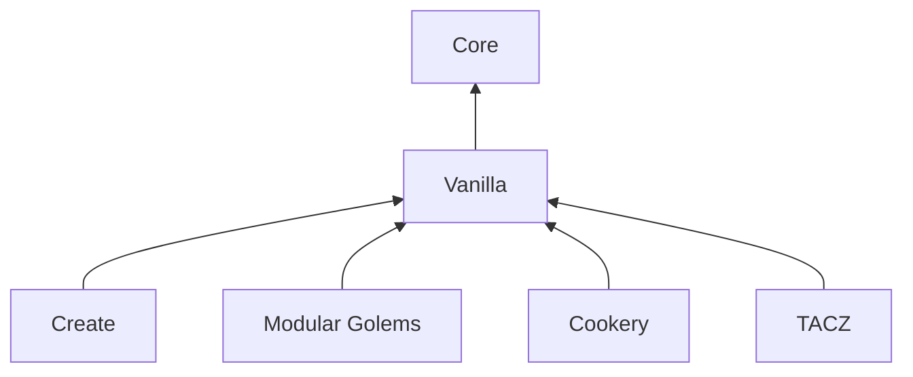

# 架构说明

[文档](README.md) · [English](../en/architecture.md)

## 模组划分

Folkways 包含**两个必装模组和四个可选扩展**，分别对应 `mods/` 下的 Gradle 子项目。
它们有独立的模组 ID，共用 `folkways` 内容命名空间。
根项目负责运行测试和收集 jar，不会构建第七个模组。

| Gradle 项目                             | 模组 ID                  | 职责                                                     |
| --------------------------------------- | ------------------------ | -------------------------------------------------------- |
| `:core` → `mods/core`                   | `folkways_core`          | 殖民地引擎、公共 API、界面与教程；单独安装不提供居民工作 |
| `:vanilla` → `mods/vanilla`             | `folkways_vanilla`       | 居民及其在原版方块中的工作                               |
| `:create` → `mods/create`               | `folkways_create`        | 列车、调度、电梯、轨道接缝与机械动力蓝图交接             |
| `:modulargolems` → `mods/modulargolems` | `folkways_modulargolems` | 傀儡居民                                                 |
| `:cookery` → `mods/cookery`             | `folkways_cookery`       | 原生 Cookery 农业、厨具、共享工具、森罗酒馆酿酒和教程    |
| `:tacz` → `mods/tacz`                   | `folkways_tacz`          | 居民枪械、实物弹药与击发生命周期                         |

为正确理解已存在的世界结构所需的兼容逻辑放入 Core，例如 Sable 子世界和机械动力装置。
为某个模组新增工作能力的集成则放入独立扩展。

## 源码位置

下表 Java 包路径均相对于各模组的 `src/main/java/io/github/izakyl/folkways/`：

| 模组 / 包                        | 内容                                                                        |
| -------------------------------- | --------------------------------------------------------------------------- |
| Core / `base`                    | 声明账本、NBT 持久化和 Mixin 插件基础                                       |
| Core / `effect`                  | 居民属性、标记和修饰项；特长位于 `effect/perk`                              |
| Core / `library`                 | 数据包与散装文件内容库                                                      |
| Core / `core`                    | 居民、规划、劳动与出行；公共 API 位于 `core/api`，世界适配位于 `core/shell` |
| Core / `front`                   | 界面、殖民书、网络与教程；公共 API 位于 `front/api`                         |
| Vanilla / `plugins`              | 基于公共 API 实现的农业、牧场、建筑等插件                                   |
| Create / `create`                | 列车、调度、`create/elevator` 与 `create/build`                             |
| Modular Golems / `modulargolems` | 傀儡居民                                                                    |
| Cookery / `cookery`              | 原生厨具和农业适配、工具、`cookery/tavern` 与教程                           |

内置样式位于 [`mods/vanilla/src/main/resources/data/folkways/folkways/pattern/`](../../mods/vanilla/src/main/resources/data/folkways/folkways/pattern/)。
集成依赖与模组 ID 以各模组的 `build.gradle` 和 `src/main/resources/META-INF/neoforge.mods.toml` 为准。

## 显示文本搜索

[`TextSearch`](../../mods/core/src/main/java/io/github/izakyl/folkways/front/api/ui/TextSearch.java)
是物品选择器、目录选择器、居民分工和库存共用的显示文本匹配入口。
客户端初始化时按需安装 JEC 适配器；文字直接命中和纯 ASCII 文本未命中时都不会调用 JEC。
适配器复用 JEC 的字典和设置，在设置变化时更新当前线程的拼写缓存。
JEC 及其 PinIn 库只用于编译，不随 Folkways 内嵌。

[`ItemQuery`](../../mods/core/src/main/java/io/github/izakyl/folkways/core/api/terms/ItemQuery.java)
的显示名称搜索重载接受 `BiPredicate<String, String>`，参数依次为名称和已转为小写的查询词。
只有普通查询词使用该匹配器；模组 ID、标签、完整物品 ID 和通配符保留注册标识符语义。
已保存的规则使用不带显示名称的原有重载，因此客户端语言或可选集成不会改变服务器的筛选行为。

## 生命周期与测试归属

Vanilla 的日常战斗、服务端居民命令和实际小队见[战斗与编队说明](combat-architecture.md)。
命令复用 Core 的安全劳动中断流程；War、RTS 界面和枪械兼容保持未来独立模块。

[`ColonyLifecycle`](../../mods/core/src/main/java/io/github/izakyl/folkways/core/api/colony/ColonyLifecycle.java)
提供迁移与关闭钩子。关闭监听器通过
[`Cleanup`](../../mods/core/src/main/java/io/github/izakyl/folkways/base/task/Cleanup.java)
隔离普通失败，避免一个阶段失败后跳过其余清理阶段。修改生命周期逻辑时应保留这一隔离行为，
对应回归场景见 [`ClosingIsolationGameTests`](../../mods/core/src/gametest/java/io/github/izakyl/folkways/core/engine/colony/ClosingIsolationGameTests.java)。

测试放在行为所属的模组中，包括需要访问包内成员的测试。
Core 的 `src/gameTestFixtures` 提供不注册测试的共享辅助代码，因此其他模组复用准备逻辑时不会顺带发现 Core 的测试。
选择某个 GameTest 所属模组，不代表移除该场景所需的其他运行时模组。
筛选参数和 CI 环境见[测试指南](testing.md)。

## 可选枪械装备

Vanilla 负责 `LoadoutRegistry` / `LoadoutProvider`、战斗页和实际补给往返。
扩展以稳定 ID 注册不可变的 `Selection` 选项、武器物品需求、备弹目标、低水位、装弹计数和界面选项。
旧版 `MELEE/BOW/CROSSBOW` 偏好会迁移为 `folkways:melee/bow/crossbow`。
未安装的扩展 ID 和选项仍会保存，但暂不启用。
`WeaponSession.continuousEngagement()` 默认关闭；启用后，`StrikeNode` 在交战期间保留主手借用。
替换或解除命令会立即关闭会话。`WeaponAdapter` 的默认重载允许按选中的实物计算射程并开启会话。
TACZ 类型及点射代次保护 Mixin 全部位于 `mods/tacz`。
