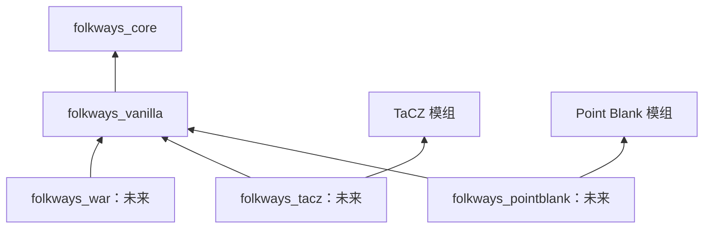

# Vanilla 战斗底座与 War 扩展边界

> 状态：第一阶段增量实施中。本文件区分 **已实现**、**待实现** 与 **未来模块**；不代表完整 RTS 已经可用。

## 设计目标

Folkways 的日常聚落不依赖 War 模组也能够应对原版危险。居民、武器、实际分队与行走行为归 `folkways_vanilla`；War 仅组织战役、袭击和 RTS 指挥界面。武器兼容模块分别接入 Vanilla 的公共接口，不直接依赖 War。



当前 Create、Cookery、Modular Golems 仍按各自现有模块边界工作。War、TaCZ、Point Blank 都不能成为 Core 或 Vanilla 的硬依赖。

## 核心职责

- **Core**：聚落与居民身份、通用劳动和出行契约、库存生命周期、权限与通用控制权交接。不得引用 War、TaCZ 或 Point Blank 类型。现有 `Locomotion`、`Conveyance`、`Trip` 仍属于通用底座。
- **Vanilla**：原版怪物与居民的日常敌对和自卫、默认近战与远程武器、实际武器所有权、基础命令、单位组与编队、站位计算、具体移动/追击及战后返岗。扩展接口可定义在 `vanilla`，不需要仅因供多个模块使用便上移到 Core。
- **War（未来独立模块）**：袭击波次、战斗实例、占点、胜负、AI 战略、战役/PvE/PvP 规则，以及左键框选、右键拖拽阵线、Ctrl+1～9 保存选择、1～9 调出选择的 RTS 客户端。War 发出高层命令，Vanilla 执行单位站位和动作。
- **TaCZ/Point Blank 等（未来独立模块）**：识别宿主武器、读取/变更真实物品、执行原生开火、换弹、弹药与动画。不得自己复制一套居民库存，也不得把枪械专有状态放进 Core。

## 第一阶段：怪物与居民的基本敌对

- Vanilla 为原版僵尸、骷髅补充对 **已加入聚落的 Folkways 居民** 的目标选择，保留怪物已有玩家/村民目标与原生攻击行为。
- 仅在服务端的实体进入世界事件中安装目标逻辑；同一个实体实例重复进入不会累加相同 Goal；重新从存档加载的新实体实例仍可以重新安装。
- 目标识别通过 Core 的 `Bodies.of(entity)` 与 `Body.colonyId()`，兼容未来其他 `ResidentKind`，不只绑定 `ResidentEntity`。
- **暂不修改末影人**：其原版中立/愤怒语义需单独制定配置与测试，不能以「所有怪物都无条件主动仇恨居民」取代。
- 本阶段不提供袭击波次、PvP 阵营、战斗结算，亦不提供枪械支持。

## 后续 Vanilla API 边界（尚未实现）

### 控制权

`core` 定义与战斗无关的通用控制权租约。租约规定 owner、优先级、接管/释放、卸载或死亡清理，以及安全中断劳动任务。任意时刻只有一个控制器写入移动和手部动作。Vanilla 的日常战斗从 Core 取得控制权，释放后由劳动系统按**最新**安排恢复工作，不能回放过期节点。首个纵向测试：劳动 → 征召/移动/驻守/撤退 → 释放 → 返岗。

### 武器与真实物品

`ResidentEntity.presentHeldItem(copy)` 是工作中的表现副本，`sweepStrayHandStack()` 还会回收非展示主手；枪械不得直接用这个副本维护弹药、耐久和组件。Vanilla 应独立实现真实装备的借用、装备槽、释放、掉落和持久化，避免复制；一般衣甲继续复用 Core 已有 `Equipment`，其 `HUMANOID_ARMOR` 限制不能误当成枪械主手接口。

Vanilla 将提供 `WeaponAdapter`/`WeaponSession` 风格的版本化扩展契约：识别装备、瞄准/使用、换弹、状态、停火及释放。第三方武器始终通过其原生模组执行，弹药从真实装备/背包中变更。接口必须允许「停止提交新指令」与「既有连发动作仍需结束」这类非瞬时状态。默认近战、弓弩同样使用接口。

### UnitGroup 与阵型

Vanilla 的 `UnitGroup` 是实际协作队伍；War 客户端的快捷控制组仅是某个玩家保存的选择集，同一个单位可以出现在多个快捷组，但不能被多个实际站位控制器同时驱动。Vanilla 接受移动、集合、跟随、驻守、攻击、撤退等意图，计算可达阵位并应对窄路、成员失联、地形与重组；War 决定战术目的，不负责每个实体的逐 tick 路径计算。

### 敌我与战斗会话

Vanilla 定义日常的友方/中立/敌对查询，区分索敌许可和实际伤害许可；War 在自己的战斗实例内提供限时阵营/规则覆盖。战斗结束后必须释放覆盖，避免将临时 PvP 关系写成永久世界仇恨。服务端重新校验每条玩家命令的成员资格、目标和作用范围。

## 迭代顺序与测试

1. **当前增量**：僵尸/骷髅目标扩展与 GameTests，验证重复安装、居民加入前后、普通中立实体不被误识别、末影人仍按原版逻辑。
2. **第二增量**：居民自卫/避险与现有巡逻复用，包含击退、逃跑和伤害来源测试。
3. **第三增量**：Core 通用安全控制权接管；Vanilla 单人移动/驻守/撤退/释放返岗，重点覆盖现有工序与材料不丢失。
4. **第四增量**：Vanilla UnitGroup、简单横队目标站位与地形重组；不要求 War 才能建立实际队伍。
5. **第五增量**：Vanilla 实物武器会话，之后由独立 TaCZ、Point Blank 模块分别验证原生接口。War 袭击和 RTS 控制另行立项。

建议运行：

```sh
npm ci
npm run setup
./gradlew check
./gradlew -PgameTestMod=vanilla runGameTestServer
npm run format:md:check
```

GameTest 环境需要接受 Minecraft EULA，参见 [测试指南](testing.md)。本阶段首要回归：原有巡逻、僵尸和骷髅目标、未登记居民/普通生物不受影响、实体重复加入/从存档重新载入。后续大规模场景按 16/32/64 单位分别测量 TPS、索敌与路径开销；这些只是测试档位，不是已达到的性能指标。

## 发布边界

`core + vanilla` 是必装基础。没有 War 的存档中日常战斗保持可用；没有枪械模组时原版战斗保持可用。所有未来战斗模块不得强制在服务器安装未使用的第三方 MOD。新玩法优先通过小范围扩展和黑箱游戏测试实现，避免一次性重写现有的劳动调度与寻路。
